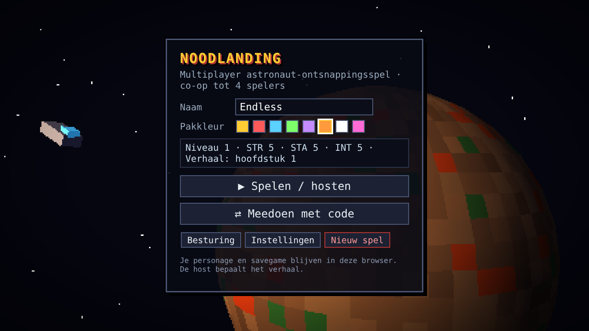
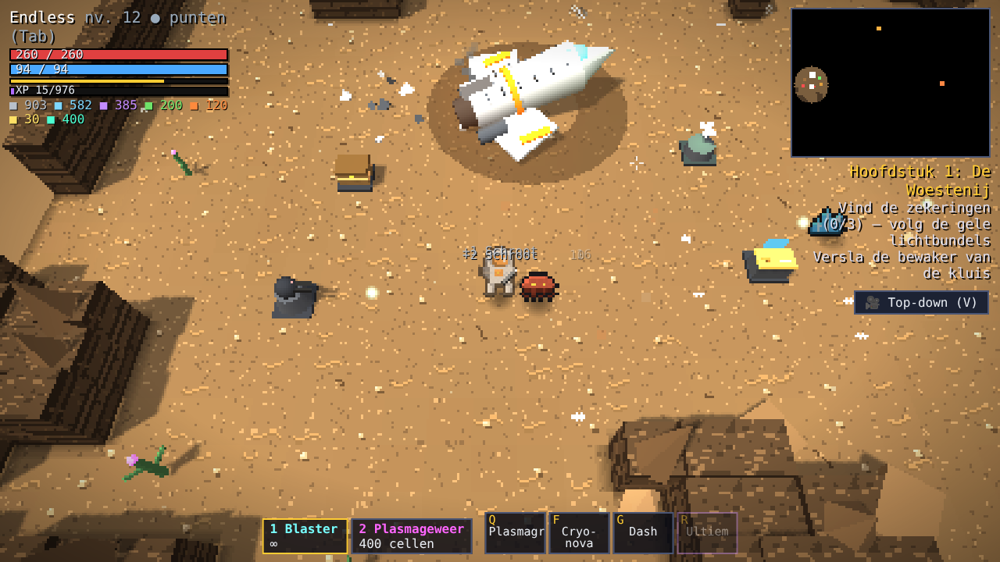
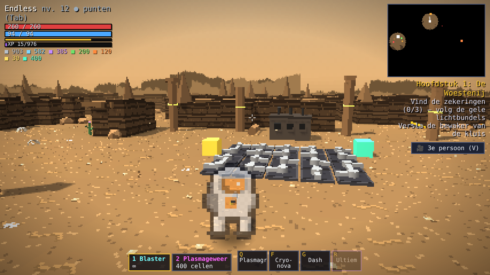
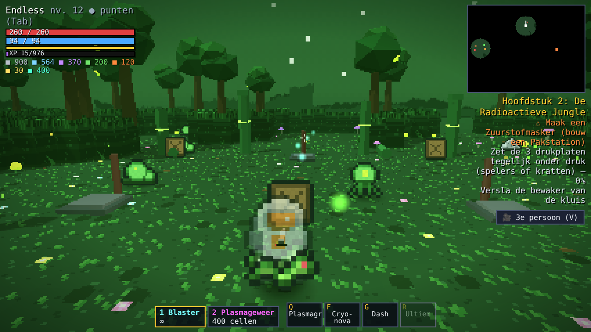
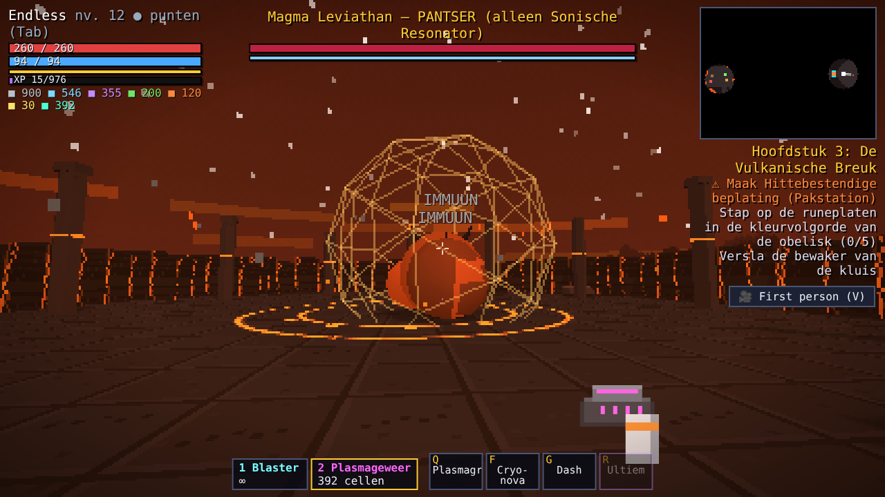
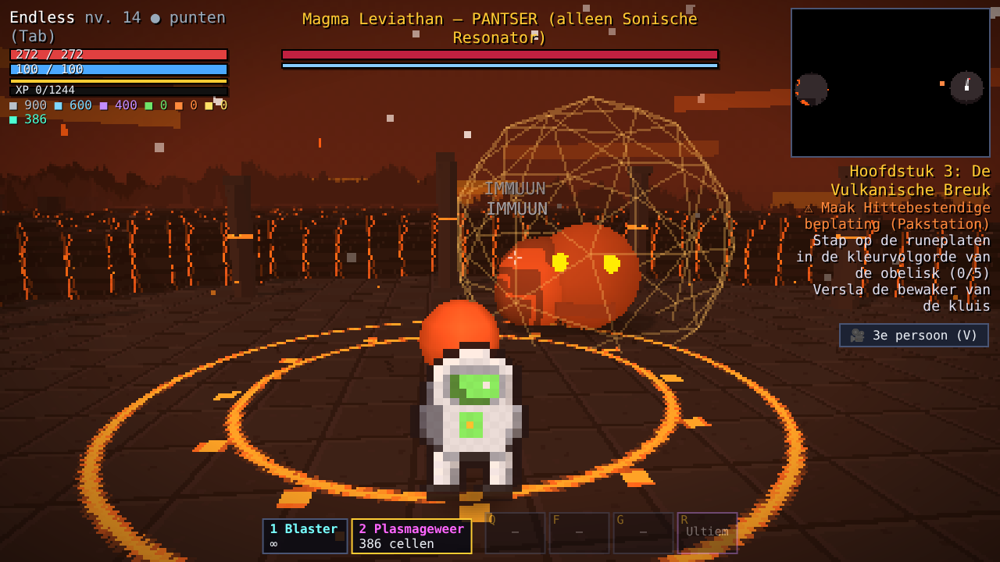
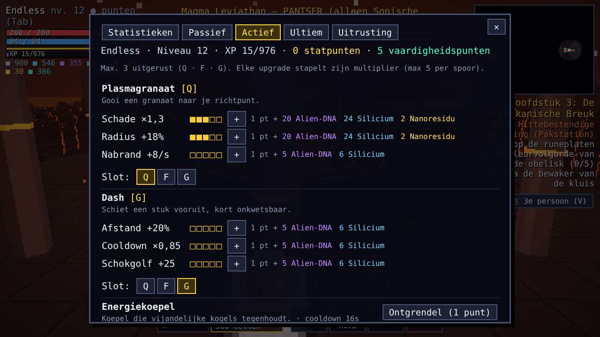
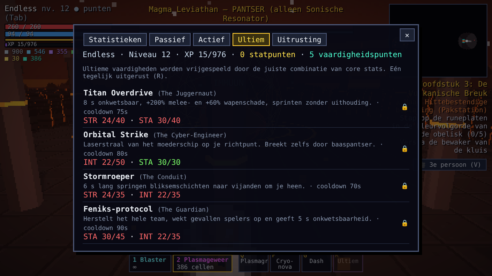

# 🚀 Noodlanding

**Multiplayer astronaut-ontsnappingsspel in de browser.** Je bent neergestort op een vijandige planeet. Verzamel grondstoffen, bouw samen een basis, los tempelpuzzels op, vind de unieke kluiswapens, versla drie bazen en repareer het ontsnappingsschip.

3D met een retro pixel-look (three.js), co-op voor **1 tot 4 spelers** via een code van 4 tekens (PeerJS / WebRTC). Draait volledig op GitHub Pages: geen server, geen installatie.

▶ **Spelen:** [endless1977.github.io/Noodlanding](https://endless1977.github.io/Noodlanding/)



---

## Screenshots

| | |
|---|---|
|  |  |
| **Crashlocatie (top-down)**: het neergestorte schip, je eerste basis met geschuttoren, medstation, wapenbank en opslag | **De Woestenij (3e persoon)**: de leidingpuzzel bij de generator, tempelzuilen en rotspieken |
|  |  |
| **De Radioactieve Jungle**: gifspuwers, rankenkruipers en de kratten voor de drukplaatpuzzel | **First person**: de Magma Leviathan is immuun zolang zijn pantser heel is |
|  |  |
| **Baasgevecht in 3e persoon**: de arena met runencirkel in de Vulkanische Breuk | **Actieve vaardigheden**: stapelbare upgradesporen per vaardigheid |



---

## Hoe speel je samen

1. De host kiest **Spelen / hosten**, kiest een hoofdstuk en laat **Open voor vrienden** aangevinkt.
2. Er verschijnt een **code van 4 tekens** (ook te zien in het pauzemenu, Esc).
3. Vrienden kiezen **Meedoen met code** en vullen de code in.

De **host bepaalt het verhaal**: welk hoofdstuk er gespeeld wordt en of de wereld wordt opgeslagen. Iedere speler neemt **zijn eigen personage** mee (level, stats, wapens, vaardigheden) naar elke game.

## Het verhaal: vier hoofdstukken

| # | Zone | Gevaar / vereiste | Puzzel | Kluiswapen | Baas |
|---|---|---|---|---|---|
| 1 | **De Woestenij** | – | 3 zekeringen zoeken (volg de gele lichtbundels), leidingen draaien tot de stroom van geel naar cyaan loopt | Boogontlader | Schrootcolossus |
| 2 | **De Radioactieve Jungle** | Gifgas: **Zuurstofmasker** nodig | 3 drukplaten **tegelijk** onder druk houden (spelers of kratten), terwijl golven vijanden aanvallen | Sporenbrander | Moederplant |
| 3 | **De Vulkanische Breuk** | Hitte en lava: **Hittebestendige beplating** nodig, plasma aanbevolen | Runeplaten aanraken in de kleurvolgorde die de obelisk laat zien | Sonische Resonator | Magma Leviathan |
| 4 | **De Ontsnapping** | Alle vijandtypes | Schip repareren met de 3 scheepsonderdelen en materialen uit de gedeelde opslag | – | 90 seconden stand houden tijdens de lancering |

**Baastoegang:** elke baas is **immuun** totdat zijn pantser gebroken is met het unieke wapen uit de kluis van die zone. De kluis wordt bewaakt door een mini-baas. Daarna is de baas 10 seconden kwetsbaar en kan het hele team schade doen. Orbital Strike breekt ook door baaspantser.

## Je personage

- **Core stats: STR / STA / INT**, met 3 punten per niveau.
  - STR: wapen- en melee-schade
  - STA: HP, schild, uithouding, snelheid
  - INT: vaardigheidskracht, schildherstel, kortere cooldowns, meer opbrengst
- **Passieve upgrades**: oneindig door te levelen met grondstoffen (HP, schade, kritiek, snelheid, opbrengst, schildherstel).
- **Actieve vaardigheden**: maximaal 3 uitgerust (Q · F · G). Elke vaardigheid heeft 3 upgradesporen van 5 niveaus waarvan de multipliers op elkaar stapelen.
  Plasmagranaat · Dash · Energiekoepel · Genezingsdrone · Overcharge · Cryo-nova
- **Ultieme vaardigheden**: vrij te spelen met de juiste stat-combinatie:

| Build | Ultiem | Vereist |
|---|---|---|
| The Juggernaut | **Titan Overdrive**: 8 s onkwetsbaar, +200% melee | 40 STR / 40 STA |
| The Cyber-Engineer | **Orbital Strike**: laserstraal van het moederschip | 50 INT / 30 STA |
| The Conduit | **Stormroeper**: 6 s bliksem op alles om je heen | 35 STR / 35 INT |
| The Guardian | **Feniks-protocol**: heelt en reanimeert het hele team | 45 STA / 35 INT |

## Wapens & synergie

Blaster · Schrootkanon · Cryo-blaster · Plasmageweer · Railgun, plus de drie unieke kluiswapens. Elk wapen kan je tot niveau 5 upgraden bij de Wapenbank. Zware wapens gebruiken energiecellen.

**Synergie:** de Cryo-blaster bevriest vijanden en het Plasmageweer **verbrijzelt** bevroren vijanden voor ×2,5 schade. Ideaal om met z'n tweeën te spelen.

## Samen een basis bouwen (B)

| Gebouw | Functie |
|---|---|
| Wapenbank | Wapens maken en upgraden, energiecellen fabriceren |
| Pakstation | Zuurstofmasker, hittebeplating, pantser I–III |
| Opslagkist | Gedeelde opslag voor het hele team |
| Munitiefabriek | Maakt elke 15 s energiecellen |
| Geschuttoren | Schiet automatisch op vijanden |
| Medstation | Geneest spelers in de buurt, respawnpunt |

## Opslaan & hoofdstukken

- **Autosave** elke 20 seconden, en bij elke belangrijke gebeurtenis.
- Je savegame staat in je browser. Via **Instellingen** kun je hem exporteren en importeren.
- **Hoofdstuk-snapshots:** de eerste keer dat je een hoofdstuk betreedt, wordt je personage vastgelegd. Speel je een eerder hoofdstuk opnieuw, dan speel je met de wapens, materialen en vaardigheden **van toen**. Je hoofd-savegame blijft onaangeroerd, dus je loopt niet met eindgame-wapens door de vroege puzzels.

## Besturing

| Toets | Actie |
|---|---|
| **WASD** | Lopen (Shift = sprinten) |
| **Muis** | Richten / rondkijken · links schieten · rechts of Z melee |
| **V** | Camera: **top-down → 3e persoon → first person** |
| **Scrollwiel / + −** | Zoomen (in first person: beeldhoek) |
| **Q · F · G** | Actieve vaardigheden |
| **R** | Ultieme vaardigheid |
| **1 · 2 · X** | Wapen kiezen / wisselen |
| **E** | Gebruiken / oppakken (vasthouden = teamgenoot reanimeren) |
| **Tab / I** | Upgrade-menu |
| **B** | Bouwen |
| **M** | Grote kaart |
| **Esc** | Pauze |

**Controller** wordt ondersteund: sticks voor lopen en richten, RT schieten, LT melee, A gebruiken, X/Y/B vaardigheden, RB ultiem, LB wapen wisselen, D-pad ↑↓ zoom en → camera, Start menu.

In 3e persoon en first person klik je eerst in het spel om de muis te vangen.

## Techniek

- **three.js r128**: laag-resolutie rendering voor de pixel-look, pixel-art sprites als billboards, schaduwen, dynamische lichten van schoten en explosies.
- **PeerJS 1.5.4**: peer-to-peer verbinding. De host simuleert de wereld, spelers sturen hun positie en acties.
- Procedurele, deterministische levels per hoofdstuk, zodat iedereen dezelfde wereld ziet.
- Geluid wordt live gesynthetiseerd met WebAudio, er zijn geen audiobestanden.
- Beide libraries staan lokaal in `lib/`.

```
index.html  style.css
js/  util · data · sprites · world · decor · audio · net · sim · game · render3d · ui · main
lib/ three.min.js · peerjs.min.js
screenshots/
```

**Prestaties:** hapert het op een zwakkere pc, zet dan in **Instellingen** de pixelgrootte op 4×.

## GitHub Pages aanzetten

Settings → Pages → *Deploy from a branch* → `main` / `(root)` → Save.
